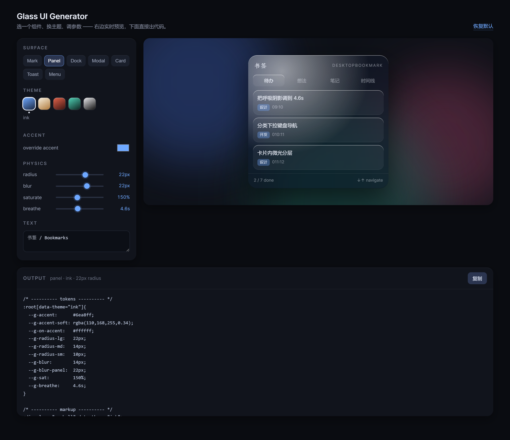

# Glass UI Generator

A free, single-file glassmorphism CSS generator. Pick a surface, tune the physics, copy the CSS. No login, no build step, no dependencies.

**Live:** https://8-321.github.io/glass-ui-generator/



## What it does

- 7 surfaces: mark, panel, dock, modal, card, toast, keyboard menu
- 5 themes driven by 24 CSS variables: ink, paper, cinnabar, celadon, midnight
- Live sliders for radius, blur, saturation and breathing period
- Outputs tokens + markup + component CSS, ready to paste

## The 7 rules it enforces

1. No border on glass — a radial-gradient highlight instead
2. Blur always ships with `saturate(150%)`
3. The light sheen stops at 55% and parks off-screen
4. Breathing shadow animates spread, not colour
5. Dividers are `inset box-shadow`, never `border`
6. Zero emoji — icons are `::before` / `::after`
7. Never animate `backdrop-filter`

## Why

Most glassmorphism tutorials stop at `backdrop-filter: blur()`. That produces a grey box. The difference between grey box and glass is four numbers and one deleted border, and nobody writes them down.

## Files

```
index.html   the whole generator, one file
preview.png  screenshot
dock.png     dock variant
```

## License

MIT for the page and the generated CSS.
